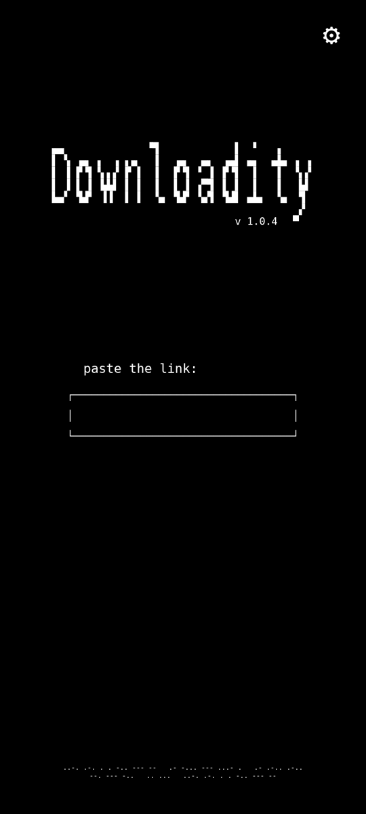
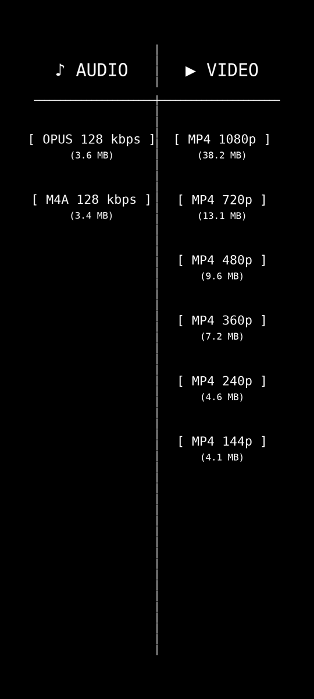
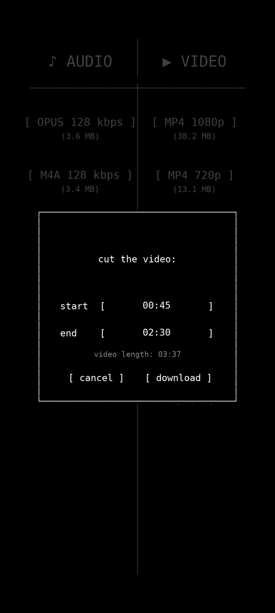
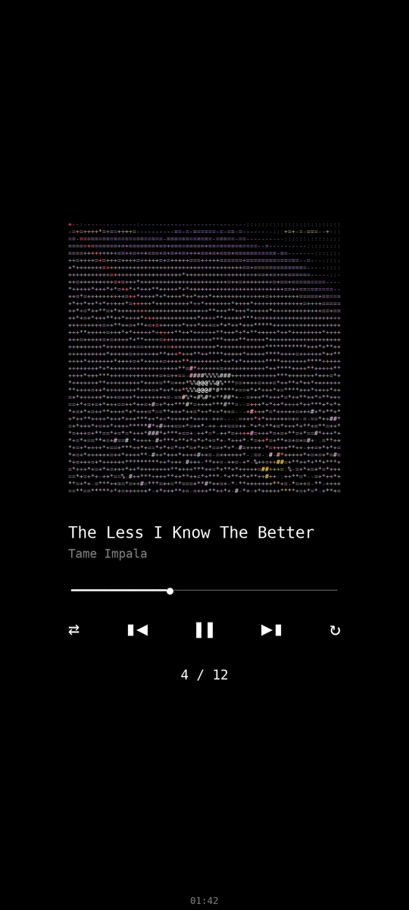

<picture>
  <source media="(prefers-color-scheme: dark)" srcset="docs/logo-dark.svg">
  
</picture>

**downloadity** is a minimalist Android app for downloading single songs and videos or **entire playlists**.
Paste a link from YouTube, YouTube Music, Spotify, Instagram, Tiktok, X or other sites, then pick a quality.
The files go straight to your phone, with cover art and tags, and there are **no ads** or accounts.

## Screenshots

<table>
  <tr>
    <td align="center"> Paste any link  </td>
    <td align="center"> Pick a quality  </td>
  </tr>
  <tr>
    <td align="center">  Cut a video</td>
    <td align="center">  Download a playlist</td>
  </tr>
</table>

## Installation

1. On your Android phone, open the [latest release](https://github.com/eggplanta/downloadity/releases/latest)

2. Under **Assets**, tap the `.apk` file to download it

3. Open the downloaded file. If Android says it can't install apps from this source, tap **Settings**, turn on **Allow from this source** and go back

4. Tap **Install**. If Google Play Protect warns you, tap **Install anyway**. The app isn't on the Play Store, so this warning is expected

5. Open **downloadity** and allow notifications. They show the progress of playlist downloads

6. Download anything you want :) 
  

The app checks for new versions when it opens and updates itself, so you only do this once

Downloaded files are saved in `Download/downloadity` by default

> Requires Android 7.0 or newer on a 64-bit (arm64) device. Automatic updates need Android 10 or newer.

## Features

- **Many sources:** YouTube, YouTube Music, Spotify, Instagram, Tiktok, X and other sites supported by [yt-dlp](https://github.com/yt-dlp/yt-dlp)
- **Audio or video:** each option shows its format, quality and file size before you download
- **Whole playlists:** downloads every item. When you download the same playlist again, it can fetch only the new items
- **Cut videos:** choose a start and end time and download only that part
- **Tagged music:** audio files get the cover art, title and artist, and are named `Artist - Title`
- **ASCII player:** while downloading, the cover is drawn in colored ASCII art on a music player screen
- **Background downloads:** downloads keep going when you leave the app, with progress in the notification
- **Share:** send a downloaded video straight to another app
- **Auto updates:** new versions are offered and installed from inside the app, you don't need to do anything!

## Limits

The app has no download limit of its own, but YouTube limits how much one network can download without an account. That's roughly **300 songs or videos per hour**

- Past that point, YouTube starts blocking requests. The app waits and tries again on its own, so big playlists just slow down
- If the block lasts, the app shows *"YouTube is blocking this network"*. Wait about an hour, or switch between Wi-Fi and mobile data
- For playlists with hundreds of items, download them in parts. When you download the same playlist again, the app only fetches the items you don't have yet

## Contributing

Contributions are welcome!

- Found a bug or a link that doesn't work? [Open an issue](https://github.com/eggplanta/downloadity/issues)
- Want to add something? Fork the repo, create a branch and open a pull request

**If you like the app, consider leaving a ⭐. It helps other people find it**

